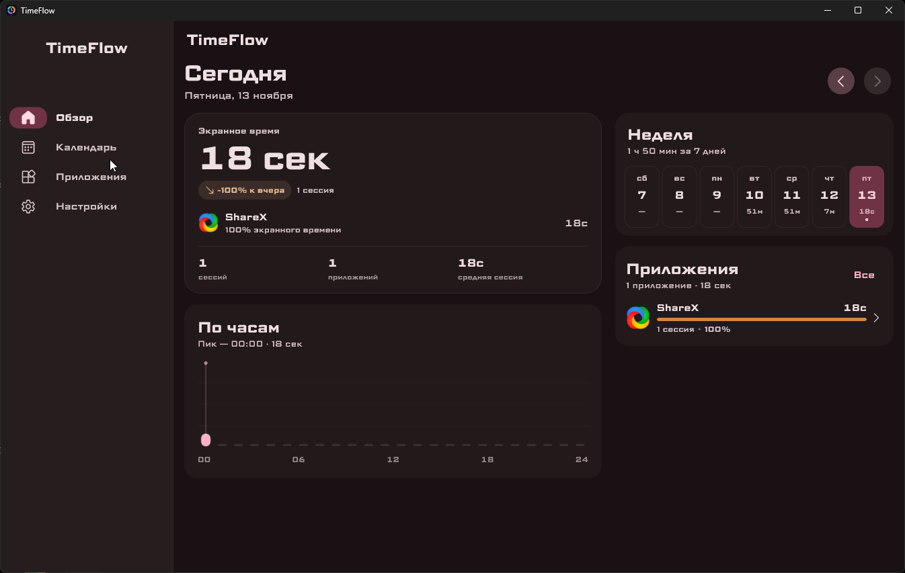
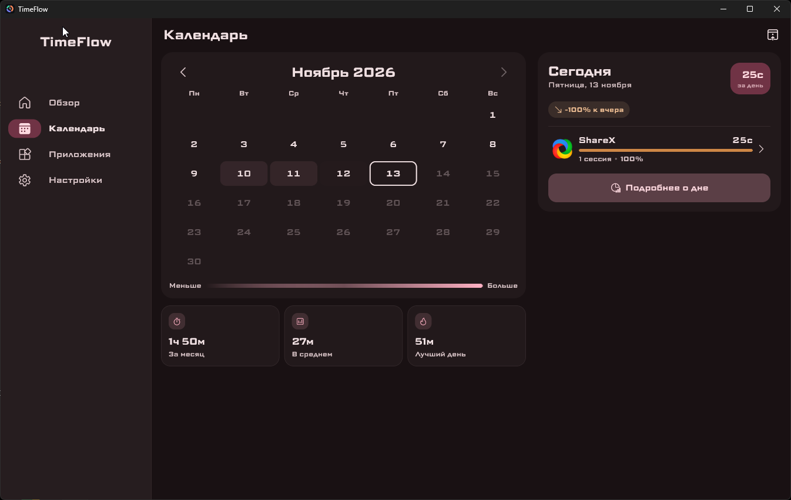
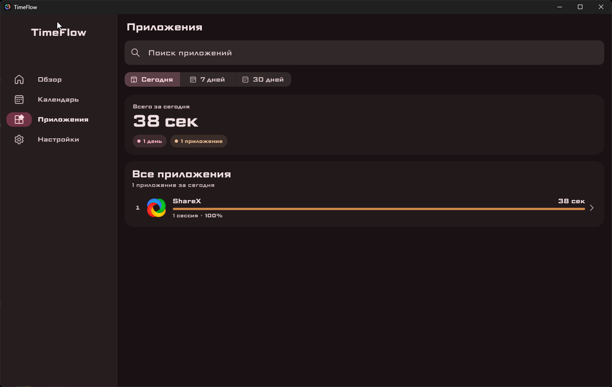
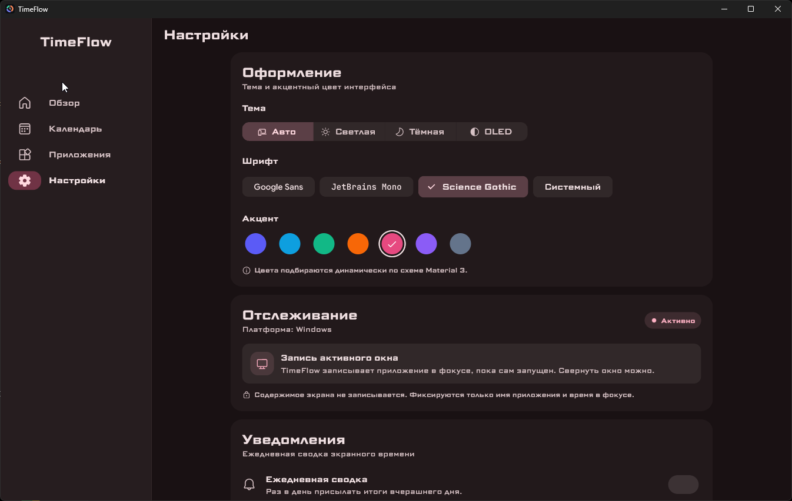

# TimeFlow

Приватный трекер экранного времени для Android, Windows и Linux. Вся статистика хранится локально.

  
  

  
  

## Функционал

- **Обзор дня** — экранное время, сравнение с прошлым днём, активность по часам и топ приложений.
- **Календарь** — история по дням с тепловой картой, суммарной статистикой за месяц и детальной разбивкой.
- **Приложения** — рейтинг, поиск, периоды «Сегодня / 7 дней / 30 дней», реальные иконки и подробная статистика по каждому приложению.
- **Настройки** — темы (включая OLED), акцентные палитры, шрифты и управление доступом к статистике.
- **Локальные данные** — экспорт и импорт истории в JSON.
- **Уведомления** — ежедневная сводка в выбранное время.
- **Демо-режим** — для платформ без системной статистики и для знакомства с приложением.

## Платформы

| Платформа | Статистика |
| --- | --- |
| Android | Системная история использования приложений |
| Windows | Активное окно и время простоя |
| Linux | Демо-режим |
